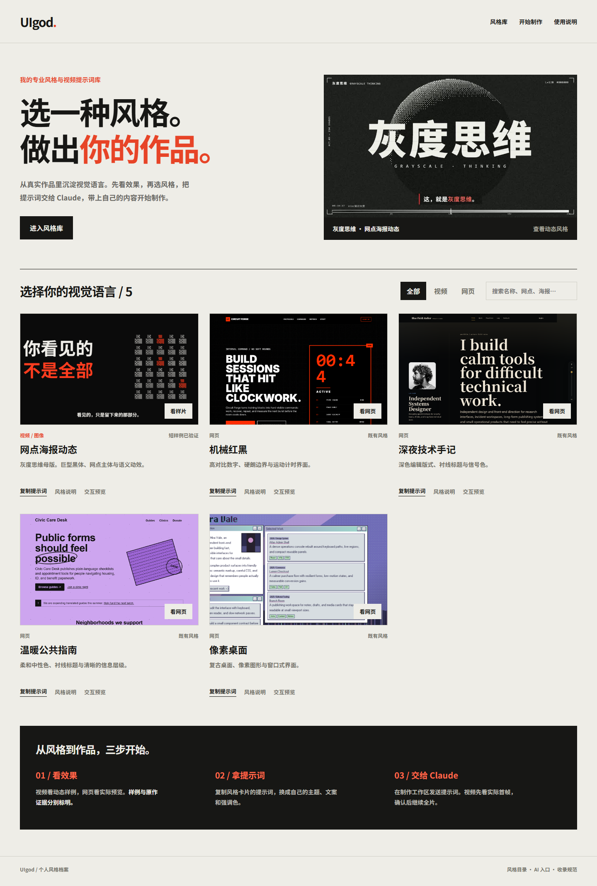
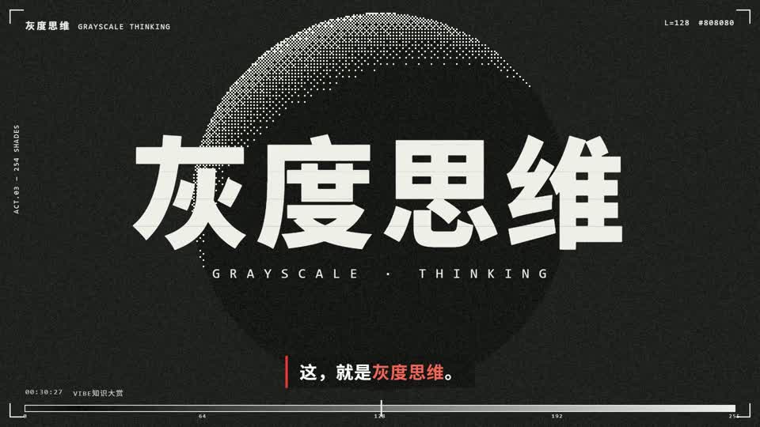
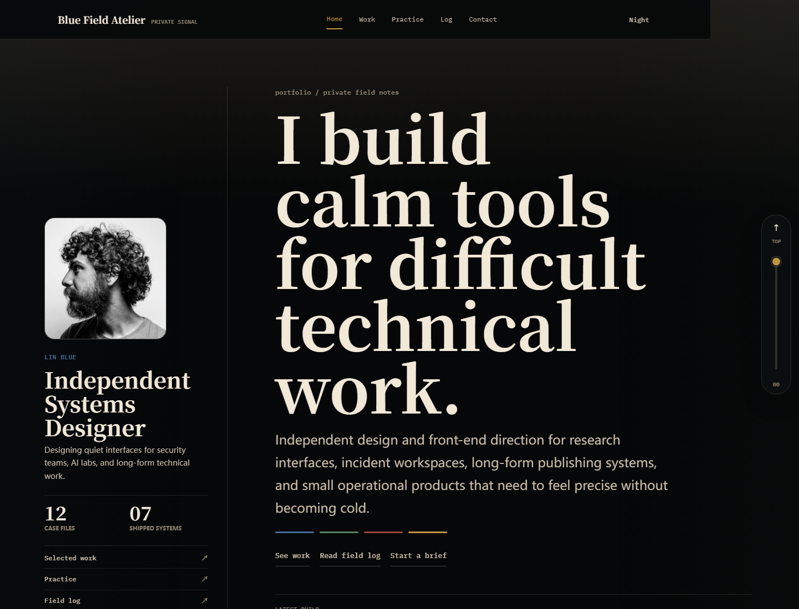
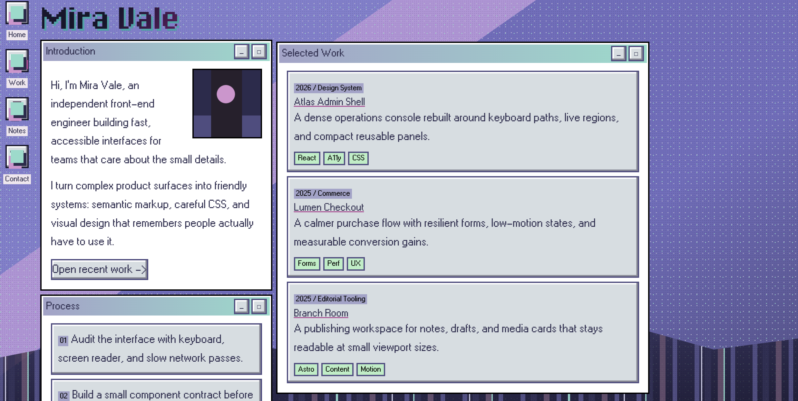

# UIgod · 我的专业风格库

选一种风格，带上自己的内容，让 Claude 开始制作。

## [进入风格库](index.html)

**看样片 · 选风格 · 复制提示词 · 开始制作**

[](index.html)

本地双击 `index.html` 即可打开，无需安装依赖或启动服务。支持视频 / 网页筛选、风格搜索、样片播放和提示词复制。GitHub 中的 HTML 文件显示源码；要使用画廊，请下载到本地后打开。

[浏览视频风格](#视频风格) · [浏览网页风格](#网页风格) · [交给-Claude](#开始制作) · [收录新风格](#收录与维护)

## 视频风格

### 网点海报动态 · 灰度思维母版

[](skills/neuroblue-halftone-motion/DESIGN.md)

巨型中文黑体、黑白网点主体、单色信号、关键词驱动的运动。适合认知、心理与技术解释，可换配色、主体和画幅。

**[看迁移样片](skills/neuroblue-halftone-motion/examples/transfer.mp4)** · [交互预览](skills/neuroblue-halftone-motion/preview.html) · [风格说明与更多提示词](skills/neuroblue-halftone-motion/DESIGN.md#prompt-guide) · [原作关键帧](skills/neuroblue-halftone-motion/references/frames/contact-sheet.jpg)

> 状态：10 秒纯视觉迁移样例已验证，无配音和音乐。原作截图、迁移样例分开保存；不代表完整一分钟成片已验收。

<details>
<summary><strong>展开并复制制作提示词</strong></summary>

```text
使用 UIgod 的“灰度思维母版”风格，按当前工作区最新文案.md 制作视频。

先读取 neuroblue-halftone-motion 风格包的 SKILL.md、DESIGN.md 和参考帧。保留巨型黑体、网点轮廓、高反差与语义动效，主体和分镜根据新内容设计。

如需换色，只替换强调色，保持整体视觉语言。默认去掉 HUD、标尺和装饰小字。技术自由选择，不使用 HyperFrames，优先复用 vibe-knowledge-video 的生产工具。

默认配音、至少一分钟。先展示真实 t=0 首帧、完整文案、预计时长和开场动态构想，等我确认后继续全片。
```

</details>

## 网页风格

| 效果预览 | 风格 | 使用入口 |
|---|---|---|
| [](skills/hiitmaster-brutal-interval-timer/examples/index.html) | **机械红黑** · 强数字、硬边界、运动计时 | [风格说明](skills/hiitmaster-brutal-interval-timer/DESIGN.md) |
| [](skills/lonely-blue-field-notes/examples/index.html) | **深夜技术手记** · 深色编辑版式、衬线标题 | [风格说明](skills/lonely-blue-field-notes/DESIGN.md) |
| [](skills/namesake-soft-civic-guides/examples/index.html) | **温暖公共指南** · 柔和中性色、清晰信息层级 | [风格说明](skills/namesake-soft-civic-guides/DESIGN.md) |
| [](skills/nicchan-pixel-desktop-portfolio/examples/index.html) | **像素桌面** · 复古窗口、像素图形 | [风格说明](skills/nicchan-pixel-desktop-portfolio/DESIGN.md) |

网页条目沿用现有版本，本次未重新验收；网页风格不自动等于已验证的视频风格。

## 开始制作

**方式一：从画廊开始。** 打开 [风格库](index.html)，预览喜欢的样片，点击“复制提示词”，在自己的制作工作区交给 Claude。

**方式二：直接说风格名。**

```text
使用 UIgod 的灰度思维母版，制作《螃蟹效应》。
以最新文案.md 为准，强调色改成朱红，围绕领先、拉扯与托举设计主体。
先展示实际首帧与开场动态，等我确认后继续全片。
```

**方式三：只描述想要的效果。**

```text
使用 UIgod，为“高反差、网点主体、巨型黑体、关键词触发动效”匹配已有风格。
说明你选了哪一种，再按我的文案制作。找不到合适风格时说明需要新建。
```

当前本机已安装 Claude 与 Codex 入口。迁移到其他电脑时，将完整 `uigod` 文件夹放入助手的 skills 目录，保留内部 `skills/`、`docs/` 和 `tools/`。风格库提供设计规则，生产工作流负责配音、字幕与渲染。

## 收录与维护

每个风格保存：**设计规则 + 制作提示词 + 原作证据 + 可预览样例**。新增风格写入 `catalog.json`，重建画廊后同步副本。

- [AI 入口](SKILL.md) · [机器可读风格目录](catalog.json)
- [视频收录合同](docs/VIDEO-CONTRACT.md) · [网页收录合同](docs/CONTRACT.md)
- [历史网页画廊](docs/legacy-gallery.md)

```powershell
python tools/build_gallery.py
python tools/sync_library.py
```

主仓库：`C:/Users/asus/.codex/skills/UIgod`。创作合集：`F:/Obsi-neuroBlue/08_创作/创作Skills/uigod`。Claude 安装版：`C:/Users/asus/.claude/skills/uigod`。

入口组织参考 [Lemo-Opuscar](https://github.com/lemomo-ai/lemo-opuscar) 的样片画廊与风格提示词导航；设计规则、素材与用户确认流程以本库为准。
