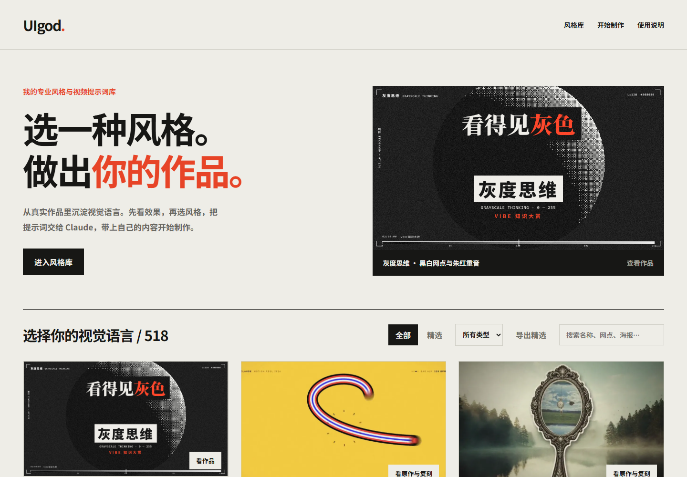
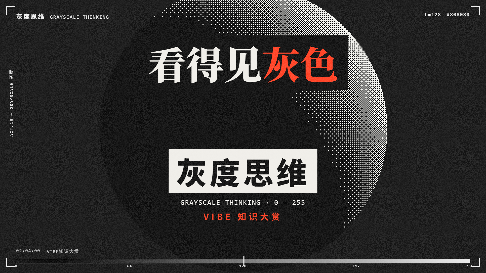
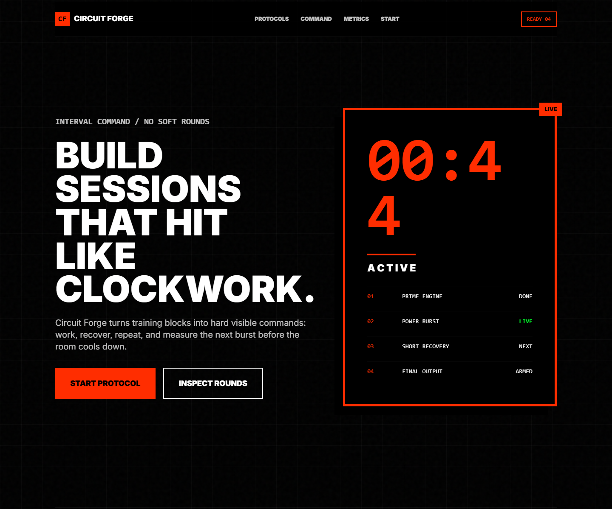
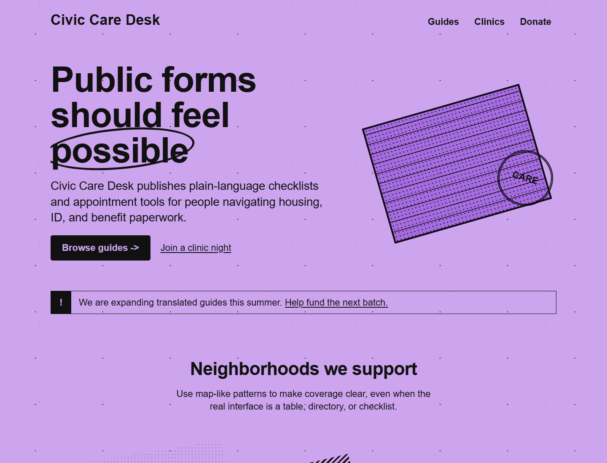

# UIgod · 视觉风格与视频提示词库

选一种风格，带上自己的内容，让 Claude 开始制作。

## [进入风格库](index.html)

**看样片 · 选风格 · 复制提示词 · 开始制作**

[](index.html)

本地双击 `index.html` 即可打开，无需安装依赖或启动服务。默认展示全部，支持全部 / 精选 / 收藏切换、媒介筛选、全文搜索、样片预览和提示词复制。GitHub 中的 HTML 文件显示源码；要使用画廊，请下载到本地后打开。

[浏览视频风格](#视频风格) · [浏览网页风格](#网页风格) · [交给-Claude](#开始制作) · [收录新风格](#收录与维护)

## 浏览与维护规则

- **全部**：默认展示全部有效条目；公开精选置顶，其余按首次收录时间倒序，固定 ID 决定同序条目先后。
- **精选**：由维护者明确挑选并排列，当前为“灰度思维”。精选不等于已经复现验证。
- **收藏**：浏览者在卡片点击“收藏 / 取消收藏”，仅保存在当前浏览器，可导出 bookmarks.json，不改变公开精选。
- **分类**：媒介、内容类型、视觉标签、技术标签分开；未分析的作品标“待命名”，用途不明确时归“待分类”。

当前包含 **5 个可复用风格包 + 513 条外部视频参考**。人工整理与上游原始数据独立保存，同步不覆盖名称、简介、精选与首次收录时间。

[仓库规则](docs/LIBRARY-RULES.md) · [贡献与维护流程](CONTRIBUTING.md) · [AI 修改规则](AGENTS.md) · [维护记录](docs/MAINTENANCE-LOG.md)

### Awesome Opus 5.5 Videos 全量收录

已收录 [yihui-dev/awesome-opus5-5-videos](https://github.com/yihui-dev/awesome-opus5-5-videos) 的全部 513 条数据、513 份提示词文件及上游 README、MIT 授权。保留原作者、原帖、海报、原作与复刻预览地址，以及提示词不完整标记。远程视频保留链接，不重复下载或把作者作品冒充本库样片。

[原始清单](collections/awesome-opus5-5-videos/data/videos.json) · [逐条提示词](collections/awesome-opus5-5-videos/prompts/) · [导入版本与完整性记录](collections/awesome-opus5-5-videos/IMPORT.json) · [上游说明及作者署名](collections/awesome-opus5-5-videos/README.md)

“外部参考”尚未逐条审美分析，也不等于 513 个已验证风格。挑为精选后仍保留其验证状态。

## 视频风格

### 灰度思维 · 黑白网点与朱红重音

[](skills/style-manager/styles/neuroblue-halftone-motion/DESIGN.md)

[创作源视频](https://www.douyin.com/jingxuan/search/%E7%81%B0%E5%BA%A6%E6%80%9D%E7%BB%B4?aid=bc2a1580-7c23-4f0b-8657-2eb472c8d99a&modal_id=7693969558939421994&type=general)（用户提供，仅作来源记录；视觉母版仍是本地成片）。

黑白网点塑形，超大文字推进，朱红在转折处爆发。用分屏对照、人物侧影与球体变化，把抽象判断做成紧凑的动态海报。

展示图选自原工程 `snapshots/v2`：尾声海报、黑白分屏、信任侧影与红色反转。适合认知、心理与知识解释；新作品可替换主题、主体和强调色。

**[看原作展示](skills/style-manager/styles/neuroblue-halftone-motion/showcase.html)** · [看迁移样片](skills/style-manager/styles/neuroblue-halftone-motion/examples/transfer.mp4) · [交互预览](skills/style-manager/styles/neuroblue-halftone-motion/preview.html) · [风格说明与更多提示词](skills/style-manager/styles/neuroblue-halftone-motion/DESIGN.md#prompt-guide) · [原作关键帧](skills/style-manager/styles/neuroblue-halftone-motion/references/frames/contact-sheet.jpg)

> 状态：10 秒纯视觉迁移样例已验证，无配音和音乐。原作截图、迁移样例分开保存；不代表完整一分钟成片已验收。

<details>
<summary><strong>展开并复制制作提示词</strong></summary>

```text
使用 UIgod 的“灰度思维母版”风格，按当前工作区最新文案.md 制作视频。

先读取 neuroblue-halftone-motion 风格包的 SKILL.md、DESIGN.md 和参考帧。保留巨型黑体、网点轮廓、高反差与语义动效，主体和分镜根据新内容设计。

如需换色，只替换强调色，保持整体视觉语言。工具选择与是否保留装饰细节遵循当前项目要求和本地偏好。

按工作区要求与 preferences.local.json 确定声音、时长和首帧确认方式；需要确认时先提交真实 t=0 画面与完整文案。
```

</details>

## 网页风格

| 效果预览 | 风格 | 使用入口 |
|---|---|---|
| [](skills/style-manager/styles/hiitmaster-brutal-interval-timer/examples/index.html) | **机械红黑** · 强数字、硬边界、运动计时 | [风格说明](skills/style-manager/styles/hiitmaster-brutal-interval-timer/DESIGN.md) |
| [](skills/style-manager/styles/lonely-blue-field-notes/examples/index.html) | **深夜技术手记** · 深色编辑版式、衬线标题 | [风格说明](skills/style-manager/styles/lonely-blue-field-notes/DESIGN.md) |
| [](skills/style-manager/styles/namesake-soft-civic-guides/examples/index.html) | **温暖公共指南** · 柔和中性色、清晰信息层级 | [风格说明](skills/style-manager/styles/namesake-soft-civic-guides/DESIGN.md) |
| [](skills/style-manager/styles/nicchan-pixel-desktop-portfolio/examples/index.html) | **像素桌面** · 复古窗口、像素图形 | [风格说明](skills/style-manager/styles/nicchan-pixel-desktop-portfolio/DESIGN.md) |

网页条目沿用现有版本，本次未重新验收；网页风格不自动等于已验证的视频风格。

## 开始制作

**方式一：从画廊开始。** 打开 [风格库](index.html)，预览喜欢的样片，点击“复制提示词”，在自己的制作工作区交给 Claude。

**方式二：直接说风格名。**

```text
使用 UIgod 的灰度思维母版，制作《螃蟹效应》。
以最新文案.md 为准，强调色改成朱红，围绕领先、拉扯与托举设计主体。
先展示实际首帧与开场动态，等我确认后继续全片。
```

**方式三：只描述想要的效果。**

```text
使用 UIgod，为“高反差、网点主体、巨型黑体、关键词触发动效”匹配已有风格。
说明你选了哪一种，再按我的文案制作。找不到合适风格时说明需要新建。
```

支持 Claude 与 Codex。将完整 `uigod` 文件夹放入助手的 skills 目录，保留内部 `skills/`、`skills/uigod/docs/` 和 `skills/uigod/tools/`。风格库提供设计规则，生产工作流负责配音、字幕与渲染。

## 收录与维护

每个正式风格保存：**设计规则 + 制作提示词 + 原作证据 + 可预览样例**。新增风格登记 style.json 和 editorial.json，再生成 catalog.json 与画廊；不要直接编辑生成文件。

- [风格提炼入口](skills/uigod/SKILL.md) · [风格选择入口](skills/style-manager/SKILL.md) · [机器可读风格目录](catalog.json)
- [每个作品放什么、不放什么](skills/uigod/docs/WORK-CONTRACT.md)
- [视频收录合同](skills/uigod/docs/VIDEO-CONTRACT.md) · [网页收录合同](skills/uigod/docs/CONTRACT.md)
- [历史网页画廊](skills/uigod/docs/legacy-gallery.md)

```powershell
python skills/uigod/tools/build_catalog.py
python skills/uigod/tools/build_gallery.py
python skills/uigod/tools/validate_library.py
python -m unittest discover -s skills/uigod/tests
```

更新外部清单时运行 `python skills/uigod/tools/import_opus_videos.py`。本地同步目标配置见 sync.example.json；个人制作偏好见 preferences.example.json，实际 local 配置不提交。

入口组织参考 [Lemo-Opuscar](https://github.com/lemomo-ai/lemo-opuscar) 的样片画廊与风格提示词导航；设计规则、素材与用户确认流程以本库为准。
